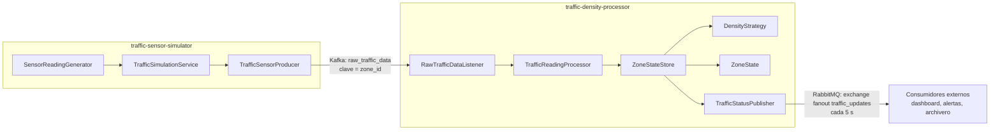

# Smart-Traffic

Sistema inteligente de monitoreo de tráfico en tiempo real basado en
microservicios y mensajería. Esta entrega contiene la parte del **Integrante 1
(Daniel)**:

- `traffic-sensor-simulator`: genera lecturas de vehículos por zona y las
  publica en Kafka.
- `traffic-density-processor`: consume esas lecturas, calcula la densidad por
  zona con los patrones **Strategy** y **State**, y publica el estado agregado
  de todas las zonas en RabbitMQ.

La infraestructura local (Kafka en modo KRaft y RabbitMQ con consola de
administración) está en `infrastructure/`.

> **Fuera del alcance de esta entrega:** `traffic_archiver`,
> `user_dashboard_backend`, `alert_dispatcher`, `query_client`, `dashboard.html`
> y PostgreSQL. Esos componentes pertenecen a los otros integrantes y se
> representan en los diagramas como consumidores externos.

## Arquitectura



- **Kafka** transporta las lecturas crudas, conserva el histórico del topic y
  permite reprocesarlas. La clave es `zone_id`, por lo que las lecturas de una
  misma zona mantienen el orden dentro de una partición.
- **RabbitMQ** distribuye el estado agregado periódico a todos los suscriptores
  mediante un exchange **fanout**.
- El procesador mantiene el estado de las zonas en memoria con una ventana
  acotada de lecturas por zona.

## Estructura

```text
Smart-Traffic/
├── docs/
│   ├── daniel-kafka.md                    # Guía técnica de Kafka, contratos y operación
│   ├── guia-estudio-integrante-1.md       # Guía de estudio en 33 temas
│   ├── explicacion-clases-integrante-1.md # Explicación clase por clase
│   └── flujo-completo-smarttraffic.md     # Flujo E2E con diagramas Mermaid
├── infrastructure/
│   ├── docker-compose.yml                 # Kafka KRaft + RabbitMQ
│   ├── .env.example                       # Credenciales locales de desarrollo
│   └── README.md                          # Comandos de infraestructura
├── services/
│   ├── traffic-sensor-simulator/
│   │   ├── Dockerfile                     # Build multi-etapa, usuario no root
│   │   └── ...
│   └── traffic-density-processor/
│       ├── Dockerfile                     # Build multi-etapa, usuario no root
│       └── ...
├── .gitignore
└── README.md
```

## Requisitos

- Java 17
- Maven 3.9+
- Docker Desktop (infraestructura local y pruebas de integración)

El repositorio no incluye Maven Wrapper. Si se desea generarlo:

```bash
mvn wrapper:wrapper
```

## Inicio rápido

### 1. Infraestructura

```bash
cd infrastructure
docker compose up -d
docker compose ps
```

Esperar a que `smarttraffic-kafka` y `smarttraffic-rabbitmq` aparezcan como
`healthy`. Más comandos en [`infrastructure/README.md`](infrastructure/README.md).

### 2. Simulador

```bash
cd services/traffic-sensor-simulator
mvn spring-boot:run
```

Genera una lectura por zona cada 2 segundos y la publica en
`raw_traffic_data` con clave `zone_id`.

### 3. Procesador

```bash
cd services/traffic-density-processor
mvn spring-boot:run
```

Consume `raw_traffic_data` y publica el estado completo de las zonas en el
exchange `traffic_updates` cada 5 segundos.

### 4. Observar el estado en RabbitMQ

Abrir <http://localhost:15672> (usuario `smarttraffic`, clave
`smarttraffic_dev` por defecto), crear una cola y vincularla al exchange
`traffic_updates` con routing key vacía. También se puede usar la API de
administración o `rabbitmqadmin`.

## Configuración

Toda la configuración está externalizada en `application.yml` y se puede
sobrescribir con variables de entorno:

| Variable | Valor por defecto | Servicio |
|---|---|---|
| `KAFKA_BOOTSTRAP_SERVERS` | `localhost:9092` | Ambos |
| `KAFKA_TOPIC` | `raw_traffic_data` | Ambos |
| `KAFKA_TOPIC_PARTITIONS` | `3` | Simulador |
| `KAFKA_TOPIC_REPLICATION_FACTOR` | `1` | Simulador |
| `SIMULATOR_ENABLED` | `true` | Simulador |
| `SIMULATOR_INTERVAL_MS` | `2000` | Simulador |
| `SIMULATOR_ZONES` | `Zona A,Zona B,Zona C,Zona D,Zona E` | Simulador |
| `SIMULATOR_MIN_VEHICLES` | `0` | Simulador |
| `SIMULATOR_MAX_VEHICLES` | `120` | Simulador |
| `KAFKA_CONSUMER_GROUP` | `traffic-density-processor` | Procesador |
| `KAFKA_AUTO_OFFSET_RESET` | `earliest` | Procesador |
| `KAFKA_CONSUMER_CONCURRENCY` | `3` | Procesador |
| `KAFKA_RETRY_INTERVAL_MS` | `1000` | Procesador |
| `KAFKA_RETRY_MAX_ATTEMPTS` | `2` | Procesador |
| `DENSITY_STRATEGY` | `weighted-average` | Procesador |
| `DENSITY_WINDOW_SIZE` | `10` | Procesador |
| `TRAFFIC_MODERADA_THRESHOLD` | `30.0` | Procesador |
| `TRAFFIC_CONGESTIONADA_THRESHOLD` | `60.0` | Procesador |
| `RABBITMQ_HOST` | `localhost` | Procesador |
| `RABBITMQ_PORT` | `5672` | Procesador |
| `RABBITMQ_USERNAME` | `smarttraffic` | Procesador |
| `RABBITMQ_PASSWORD` | `smarttraffic_dev` | Procesador |
| `RABBITMQ_VHOST` | `/` | Procesador |
| `RABBITMQ_EXCHANGE` | `traffic_updates` | Procesador |
| `TRAFFIC_PUBLISH_INTERVAL_MS` | `5000` | Procesador |

La lista completa, los contratos JSON y los comandos de operación están en
[`docs/daniel-kafka.md`](docs/daniel-kafka.md).

## Contratos de mensajes

### Kafka: `raw_traffic_data`

Clave: `zone_id`. Valor:

```json
{
  "event_id": "6f1b8e4e-6f6a-4b52-9d3a-5c1f5d7d9f10",
  "zone_id": "Zona A",
  "vehicle_count": 45,
  "timestamp": "2026-11-12T16:00:00Z"
}
```

| Campo | Tipo | Regla |
|---|---|---|
| `event_id` | UUID | Identificador único del evento. |
| `zone_id` | string | Zona de origen; no vacío. |
| `vehicle_count` | entero | Cantidad de vehículos; mayor o igual que 0. |
| `timestamp` | ISO-8601 UTC | Instante de la lectura. |

### RabbitMQ: `traffic_updates`

Exchange `traffic_updates`, tipo **fanout**, durable, sin auto-delete. Routing
key vacía. Valor:

```json
{
  "timestamp": "2026-11-12T16:00:05Z",
  "zones": [
    {
      "zone_id": "Zona A",
      "average_vehicles": 45.0,
      "traffic_status": "MODERADA"
    },
    {
      "zone_id": "Zona B",
      "average_vehicles": 80.0,
      "traffic_status": "CONGESTIONADA"
    }
  ]
}
```

- `zones` contiene **todas** las zonas conocidas, ordenadas por `zone_id`.
- Antes de la primera lectura se publica `{"timestamp": "...", "zones": []}`.
- Los estados posibles son exclusivamente `DESPEJADA`, `MODERADA` y
  `CONGESTIONADA`.
- El conversor JSON no añade la cabecera `__TypeId__`: el contrato es el JSON y
  no depende de las clases Java del procesador.

## Pruebas

Cada servicio es un proyecto Maven independiente. Las pruebas unitarias usan
JUnit 5, Mockito y AssertJ, y **no requieren Docker, Kafka ni RabbitMQ**.

```bash
cd services/traffic-sensor-simulator
mvn -B clean test

cd ../traffic-density-processor
mvn -B clean test
```

Resultados verificados el **2026-11-12**:

| Proyecto | Pruebas unitarias | Fallos | Errores |
|---|---:|---:|---:|
| `traffic-sensor-simulator` | 19 | 0 | 0 |
| `traffic-density-processor` | 51 | 0 | 0 |
| **Total** | **70** | **0** | **0** |

### Pruebas de integración

Las pruebas de integración están separadas con el plugin **Failsafe** y la
terminación `*IT`. No se ejecutan con `mvn test`; requieren la infraestructura
real levantada:

```bash
cd infrastructure
docker compose up -d
docker compose ps

cd ../services/traffic-sensor-simulator
mvn -B -Pintegration-tests verify

cd ../traffic-density-processor
mvn -B -Pintegration-tests verify
```

Resultados verificados el **2026-11-12** contra Kafka y RabbitMQ reales:

| Proyecto | Pruebas IT | Fallos | Errores | Qué verifica |
|---|---:|---:|---:|---|
| `traffic-sensor-simulator` | 1 | 0 | 0 | Publicación real en Kafka, clave `zone_id`, campos y timestamp UTC. |
| `traffic-density-processor` | 4 | 0 | 0 | Lista vacía, transiciones controladas, límites 30/60, snapshot completo, JSON inválido, ventana de 10 y ausencia de `__TypeId__`. |
| **Total** | **5** | **0** | **0** | |

Las IT usan topics y colas temporales con nombres únicos y los eliminan al
terminar. La cola temporal del procesador es no durable y **sin auto-delete**,
porque `RabbitTemplate.receive` cancela su consumidor tras el timeout y RabbitMQ
la eliminaría antes de completar las aserciones.

## Docker

Cada servicio incluye un `Dockerfile` multi-etapa:

1. Etapa de compilación con `maven:3.9.9-eclipse-temurin-17`.
2. Etapa de ejecución con `eclipse-temurin:17-jre`.
3. Usuario `smarttraffic` sin privilegios (UID/GID 1001).
4. Sin secretos reales; las credenciales de desarrollo se pueden sobrescribir
   con variables de entorno.

### Construir las imágenes

```bash
docker build -t smarttraffic/traffic-sensor-simulator:1.0.0 \
  services/traffic-sensor-simulator

docker build -t smarttraffic/traffic-density-processor:1.0.0 \
  services/traffic-density-processor
```

### Ejecutar los contenedores

Los contenedores deben unirse a la red `smarttraffic-network` creada por
`infrastructure/docker-compose.yml` y activar el perfil `docker`, que usa los
nombres internos `kafka:29092` y `rabbitmq:5672`:

```bash
docker run --rm --name smarttraffic-simulator \
  --network smarttraffic-network \
  -e SPRING_PROFILES_ACTIVE=docker \
  smarttraffic/traffic-sensor-simulator:1.0.0

docker run --rm --name smarttraffic-processor \
  --network smarttraffic-network \
  -e SPRING_PROFILES_ACTIVE=docker \
  -e RABBITMQ_USERNAME=smarttraffic \
  -e RABBITMQ_PASSWORD=smarttraffic_dev \
  smarttraffic/traffic-density-processor:1.0.0
```

> **Importante:** el perfil `docker` está pensado **solo** para ejecución
> dentro de la red de contenedores. Un JAR lanzado en el host con
> `--spring.profiles.active=docker` intentaría resolver `kafka` y `rabbitmq`,
> nombres que no existen fuera de Docker. En el host se usan los valores por
> defecto `localhost:9092` y `localhost:5672`, sin activar ese perfil.

Para pasar opciones de JVM se puede usar `JAVA_TOOL_OPTIONS`, por ejemplo
`-e JAVA_TOOL_OPTIONS="-Xms128m -Xmx256m"`.

## Decisiones provisionales

- Los umbrales de tráfico (`30.0` y `60.0` vehículos promedio) son valores
  iniciales configurables, no una fórmula oficial del enunciado. Deben validarse
  con el equipo y el docente. Los límites son inclusivos: exactamente `30.0` es
  `MODERADA` y exactamente `60.0` es `CONGESTIONADA`.
- El promedio ponderado usa pesos `1..n`, con la lectura más reciente de mayor
  peso. Es una interpretación acordada provisionalmente.
- El rango de vehículos `0..120` es una decisión de simulación, configurable con
  `SIMULATOR_MIN_VEHICLES` y `SIMULATOR_MAX_VEHICLES`.
- La ventana de 10 lecturas por zona es configurable con `DENSITY_WINDOW_SIZE`.
- El estado de las zonas vive en memoria y se pierde al reiniciar el procesador.
  El histórico persistente corresponde al archivador de otro integrante.
- Las credenciales de RabbitMQ incluidas son exclusivamente para desarrollo
  local; no deben usarse en un entorno compartido o productivo.

## Documentación

- [`docs/daniel-kafka.md`](docs/daniel-kafka.md): guía técnica de Kafka,
  contratos, patrones, configuración, pruebas y operación.
- [`docs/guia-estudio-integrante-1.md`](docs/guia-estudio-integrante-1.md):
  guía de estudio en 33 temas con preguntas de repaso.
- [`docs/explicacion-clases-integrante-1.md`](docs/explicacion-clases-integrante-1.md):
  explicación clase por clase de ambos microservicios.
- [`docs/flujo-completo-smarttraffic.md`](docs/flujo-completo-smarttraffic.md):
  flujo extremo a extremo con diagramas Mermaid.
- [`infrastructure/README.md`](infrastructure/README.md): inicio, accesos y
  comandos de Kafka/RabbitMQ.

## Estado de verificación

Verificado el **2026-11-12** en Windows con Docker Desktop:

- Docker `29.8.0` y Docker Compose `v5.5.1`.
- `docker compose up -d`: Kafka y RabbitMQ en estado `healthy`.
- Pruebas unitarias: `19 + 51 = 70`, con 0 fallos y 0 errores.
- Pruebas de integración: `1 + 4 = 5`, con 0 fallos y 0 errores, contra Kafka y
  RabbitMQ reales.
- E2E manual con JARs empaquetados:
  - Topic `raw_traffic_data` con 3 particiones; clave igual a `zone_id` y JSON
    con los cuatro campos en UTC.
  - Exchange `traffic_updates` confirmado como `fanout` durable.
  - Primer mensaje Rabbit con `zones: []`; después, 5 zonas con estados en
    español y sin cabecera `__TypeId__`.
  - Intervalo real entre publicaciones: `5186 ms` (configurado `5000 ms`).
  - Secuencia controlada en `Zona E2E2` con estrategia ponderada:
    `DESPEJADA(10) → MODERADA(43.333) → CONGESTIONADA(76.667) →
    MODERADA(46.0) → MODERADA(30.667) → DESPEJADA(21.905)`.
  - Mensaje final agregado con 7 zonas, todas con estados en español.
  - Grupo `traffic-density-processor` con lag `0` en las 3 particiones.
  - Aplicaciones detenidas, cola temporal eliminada y contenedores aún
    `healthy`.
- Imágenes Docker de ambos servicios construidas correctamente y ejecutadas en
  la red `smarttraffic-network` con el perfil `docker`:
  - Primer mensaje Rabbit con `zones: []`; después, 2 zonas (`Zona Docker A` y
    `Zona Docker B`) con estados en español.
  - Cabeceras vacías (`headers={}`), sin `__TypeId__`.
  - Intervalo de publicación de `2000 ms` configurado y observado.
  - Contenedores detenidos y cola temporal eliminada al finalizar.
- `docker compose config --quiet`: válido.
- `mvn dependency:tree`: sin conflictos de versiones.
- Búsqueda de secretos, `TODO`, `FIXME` y excepciones silenciosas: sin hallazgos
  distintos de los `return null` intencionales y documentados del `ClassMapper`
  de RabbitMQ y de un helper de prueba.

> Las pruebas y el E2E se ejecutaron realmente. No se declaran resultados no
> comprobados. Las imágenes Docker se validaron con una ejecución de corta
> duración contra la infraestructura local.
