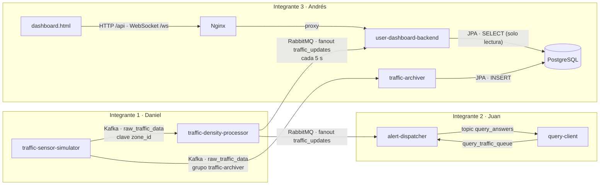

# Arquitectura de SmartTraffic

SmartTraffic simula sensores de tráfico en cinco zonas, procesa las lecturas,
calcula el nivel de congestión, guarda el historial y lo muestra en un
dashboard web en tiempo real.

## 1. Vista general



| Componente | Responsable | Tecnología | Función |
|---|---|---|---|
| `traffic-sensor-simulator` | Daniel | Spring Boot, Kafka | Genera una lectura por zona cada 2 s |
| `traffic-density-processor` | Daniel | Kafka, RabbitMQ, Strategy, State | Calcula el promedio y el estado por zona; publica un snapshot cada 5 s |
| `alert-dispatcher` / `query-client` | Juan | RabbitMQ, Observer | Alertas de congestión y consultas asíncronas |
| `traffic-archiver` | Andrés | Kafka, Spring Data JPA | Guarda cada lectura cruda en PostgreSQL |
| `user-dashboard-backend` | Andrés | RabbitMQ, REST, WebSocket, JPA | Estado actual, estadísticas e historial |
| `dashboard.html` | Andrés | HTML, CSS, JS | Interfaz web en tiempo real |
| PostgreSQL, Nginx, Compose | Andrés | Docker | Persistencia, reverse proxy, orquestación |

## 2. Flujo de un dato

1. El **simulador** crea `{"event_id","zone_id","vehicle_count","timestamp"}` y
   lo publica en Kafka con clave `zone_id` (una zona siempre cae en la misma
   partición, lo que conserva su orden).
2. Dos consumer groups leen el **mismo** topic de forma independiente:
   - `traffic-density-processor` (Daniel) actualiza el estado de la zona.
   - `traffic-archiver` (Andrés) guarda la lectura en `traffic_readings_history`.
3. Cada 5 s el **procesador** publica `{"timestamp","zones":[...]}` en el
   exchange fanout `traffic_updates`. RabbitMQ copia el mensaje a cada cola
   vinculada: `dashboard_traffic_queue` (Andrés) y la cola de Juan.
4. El **dashboard backend** actualiza su estado en memoria y empuja el
   snapshot a todos los navegadores por WebSocket.
5. El **navegador** carga el estado inicial por REST, recibe las
   actualizaciones por WebSocket y consulta el historial por REST
   (`/api/history`, leído de PostgreSQL).

## 3. Contratos

### Kafka `raw_traffic_data` (3 particiones, clave `zone_id`)

```json
{"event_id":"f33df0e7-b180-4a75-9561-569ff24f62eb","zone_id":"Zona A","vehicle_count":61,"timestamp":"2026-11-13T04:21:25.765885200Z"}
```

### RabbitMQ exchange fanout `traffic_updates` (durable, routing key vacía)

```json
{"timestamp":"2026-11-13T04:21:52.379261700Z",
 "zones":[{"zone_id":"Zona A","average_vehicles":52.87,"traffic_status":"MODERADA"}]}
```

- Estados: `DESPEJADA` (< 30), `MODERADA` (30 a < 60), `CONGESTIONADA` (≥ 60).
- El primer mensaje llega con `zones: []`.
- Sin cabecera `__TypeId__`: cada consumidor deserializa a su propio tipo.

> Los contratos del enunciado (`ZONE_01`, `LIBRE/MODERADO/CONGESTIONADO`, un
> mensaje por zona) eran provisionales. El equipo adoptó los implementados por
> el Integrante 1 porque agregan `event_id` (idempotencia) y usan UTC.

### API REST del dashboard (vía Nginx)

| Método y ruta | Respuesta |
|---|---|
| `GET /api/zones` | Lista de zonas: `zone_id`, `average_vehicles`, `traffic_status`, `last_updated` |
| `GET /api/zones/detail?zoneId=Zona A` | Una zona; `404` si no existe |
| `GET /api/stats` | `total_vehicles`, `zones_count`, `congested_zones_count`, `congested_zones`, `zones_by_status`, `last_updated`, `waiting_for_data` |
| `GET /api/history?zoneId=Zona A&from=...&to=...` | Lecturas de PostgreSQL (más reciente primero, máximo 500). `from`/`to` opcionales en ISO-8601 UTC; por defecto la última hora; rango máximo 7 días |

Errores con cuerpo uniforme:

```json
{"timestamp":"...","status":400,"error":"Bad Request","message":"La fecha 'from' debe ser anterior a 'to'","path":"/api/history"}
```

| Código | Cuándo |
|---|---|
| 400 | Parámetro faltante o inválido, regla de negocio (`ReglaNegocioException`) |
| 404 | Zona sin estado (`RecursoNoEncontradoException`) o ruta inexistente |
| 429 | Límite de peticiones de Nginx superado |
| 503 | PostgreSQL no disponible (el estado en vivo sigue funcionando) |

### WebSocket `/ws/traffic`

WebSocket nativo (sin STOMP ni SockJS). Al conectarse y en cada snapshot el
servidor envía:

```json
{"type":"traffic_update","zones":[...],"stats":{...}}
```

## 4. Diseño orientado a objetos (servicios de Andrés)

Paquetes por capa: `domain`, `dto`, `mapper`, `repository`, `service`,
`controller`/`consumer`/`messaging`, `websocket`, `exception`, `config`.

| Principio o patrón | Dónde |
|---|---|
| **Interfaces + inyección por constructor (DIP)** | Todos los servicios (`TrafficArchiveService`, `ZoneStateService`, `TrafficStatsService`, `TrafficHistoryService`...), mappers, repositorios y `TrafficBroadcaster` |
| **ISP** | `TrafficHistoryRepository` extiende `Repository` (sin `save`/`delete`) |
| **OCP** | `SmartTrafficException.getStatus()`: el `@RestControllerAdvice` no tiene un `if` por tipo de error |
| **Adapter** | `TrafficReadingMapper` (evento Kafka → entidad) y `TrafficUpdateMapper` (mensaje RabbitMQ → dominio) |
| **Modelo enriquecido** | `TrafficReading.registrar(...)` y el constructor de `ZoneState` validan las reglas |
| **Records** | DTOs, mensajes, `ZoneState`, `TrafficStats`, propiedades de configuración |
| **Jerarquía de excepciones** | `SmartTrafficException` → `ReglaNegocioException` (400), `RecursoNoEncontradoException` (404), `EventoDuplicadoException` (409) |
| **Búsquedas con `orElseThrow()`** | `ZoneController.findByZoneId` |
| **Entidades no expuestas** | Los controladores devuelven records (`HistoryReadingResponse`, ...) |

## 5. Estilos de arquitectura presentes

- **Microservicios:** seis servicios independientes, cada uno con su `pom.xml`
  y su imagen Docker.
- **Orientada a eventos (EDA) y Pub/Sub con broker:** los productores no
  conocen a los consumidores; Kafka y RabbitMQ desacoplan.
- **Cliente-servidor:** navegador ↔ API REST.
- **Reverse proxy:** Nginx es el único punto de entrada.

## 6. Kafka frente a RabbitMQ

| | Kafka (`raw_traffic_data`) | RabbitMQ (`traffic_updates`) |
|---|---|---|
| Datos | Lecturas crudas, alto volumen (2,5 msg/s) | Snapshot agregado, bajo volumen (1 msg / 5 s) |
| Modelo | **Pull**; log persistente con offsets | **Push**; el mensaje se borra al confirmarlo |
| Relectura | Sí: el archiver recuperó lecturas perdidas al reiniciarse | No |
| Varios consumidores | Un consumer group por servicio, cada uno lee todo | El fanout copia el mensaje a cada cola |
| Orden | Garantizado por partición (clave `zone_id`) | Por cola |

## 7. Tolerancia a fallos (verificada)

| Falla | Comportamiento |
|---|---|
| JSON inválido en Kafka | `ErrorHandlingDeserializer`: se descarta con log; el consumidor sigue |
| Mensaje duplicado (at-least-once) | `event_id UNIQUE` + `existsByEventId`: se ignora (idempotencia) |
| PostgreSQL caído (archiver) | Reintento sin límite del mismo offset cada 5 s; al volver la base no se pierde ninguna lectura |
| PostgreSQL caído (dashboard) | `/api/zones` sigue respondiendo; `/api/history` responde 503 |
| RabbitMQ reiniciado | Spring AMQP se reconecta solo |
| Backend del dashboard caído | El navegador muestra "Sin conexión" y reintenta con backoff exponencial (1 s → 30 s) |
| Contenedor caído | `restart: unless-stopped`; los healthchecks actúan como heartbeat |
| Mensaje RabbitMQ inválido | Se descarta (`default-requeue-rejected: false`); no hay bucle infinito |

## 8. CAP / PACELC

- **Estado en memoria del dashboard:** AP / EL. Prioriza disponibilidad y
  latencia; muestra el último snapshot recibido (consistencia eventual). Si el
  procesador se detiene, el frontend avisa que los datos están desactualizados.
- **PostgreSQL:** fuente consistente del historial (CP en un solo nodo).
- **Kafka con un solo broker y replicación 1:** no tolera la caída del broker.
  Es una limitación del entorno académico; en producción se usarían réplicas
  (líder-seguidor, ISR).

## 9. Seguridad

- Solo Nginx publica un puerto; la red `backend-net` es interna (sin salida a
  Internet).
- Usuarios de base de datos con mínimo privilegio (`archiver_user` no puede
  borrar; `dashboard_reader` solo lee).
- Credenciales en `.env` (no versionado); el Compose no arranca sin ellas.
- Nginx: `server_tokens off`, timeouts cortos, rate limiting, cabeceras de
  seguridad y bloqueo de `/.env` y `/.git`.
- CORS y WebSocket solo para orígenes configurados.
- Frontend: el DOM se construye con `textContent` (sin `innerHTML` con datos
  del servidor) para evitar XSS.
- Contenedores con usuario no root (UID 1001).
